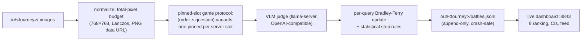

# VLM-imageArena

**An adaptive A/B image-ranking arena powered by a local VLM judge.**
Put N candidate images in a folder — a vision-language model compares them pair
by pair ("which is better?"), an adaptive scheduler picks the most informative
matchups, and a **Bradley-Terry maximum-likelihood** fit turns the vote log into
a statistically-grounded ranking with confidence intervals.


Built as a research vehicle for the question: **how reliably can a small local
VLM act as a pairwise image judge?** — including everything that goes wrong on
the way (position bias, blind judges, ties, and the hidden cost of cold
vision-encodes).

---

## Quick start (first ranking in ~5 minutes)

**You need:** Python 3.11+ and a [llama.cpp](https://github.com/ggml-org/llama.cpp/tree/master/tools/server)
`llama-server` build with a **multimodal** model — a main GGUF *plus* its
`mmproj` vision encoder (any Qwen3-VL-family model works; that's what this was
developed against). Developed on Windows — the `.bat` launchers are
Windows-only, the Python core is cross-platform.

```bat
:: 1. install (creates .venv and installs requirements)
setup.bat

:: 2. get a llama-server build — auto-downloads the latest Windows llama.cpp
::    release into llamacpp\ (picks CUDA/Vulkan/CPU for your GPU), then wires
::    JUDGE_SERVER_EXE in src\config_local.py for you. Skip this step and
::    point JUDGE_SERVER_EXE at an existing llama-server if you have one.
install.bat

:: 3. point the arena at YOUR model files
::    ...then edit src\config_local.py:
::       LLAMA_ARG_MODEL   = path to your model GGUF
::       LLAMA_ARG_MMPROJ  = path to the mmproj GGUF
::    (this file is gitignored — your paths never leave your machine)
::    Note: llama.cpp ships no models — the GGUFs stay a manual download.

:: 4. drop candidate images into  in\        (png / jpg / webp)

start_judge.bat   :: 5. judge server — prints READY when healthy (Ctrl+C stops)

start_arena.bat   :: 6. dashboard → http://127.0.0.1:8843
```

In the browser: **create a tourney → upload/pick images → press resume.**
The dashboard is the whole UI — live θ ranking with confidence intervals,
a match feed showing every individual vote, pivot/hold controls, graceful
stop. Restarting anything is safe: the arena replays `battles.jsonl` and
continues exactly where it stopped.

Prefer plain commands? Skip the bats entirely (this is also the **Linux/macOS
path** — the Python core is cross-platform):

```bash
python -m venv .venv && .venv/Scripts/pip install -r requirements.txt   # Windows
python src/install_llamacpp.py        # fetch llama.cpp into llamacpp/ (Win/Linux/macOS)
python -m src.judge_server            # judge first (auto-resolves the llamacpp/ binary)
python -m src.arena --tourney mytest  # then the arena (also: --dry-run, --no-dashboard)
```

The judge binary is resolved automatically: explicit `JUDGE_SERVER_EXE` in
`config_local.py` → the `llamacpp/` install manifest → `llamacpp/` scan →
`PATH`. Unsupported llama-server flags are dropped at launch by a `--help`
compat shim, so the arena runs whatever build the installer fetched, on
NVIDIA (CUDA), AMD (Vulkan/ROCm), Apple Silicon (Metal), or CPU.

Sanity-check a new judge before an arena run — exact arena query path, shows
vote variance and position bias:

```bash
python -m src.manual_test imgA.png imgB.png --seeds 8 --swap
```

All tunables (sampling params, stop-rule constants, pixel budget, judge
prompt) live in **`src/config.py`** with rationale comments — your machine's
paths and any overrides go in the gitignored **`src/config_local.py`**.

## How it works



- **Every query is logged** to `battles.jsonl` (prompt, seed, image order, raw
  reply, cached-token count). Restart = deterministic replay of the log —
  nothing is ever lost.
- **Order bias is measured, not assumed.** Each game fires both image orders;
  verdicts credit the *image*, not the letter, so the judge's A/B preference
  cancels out.
- **Equal pixels = equal tokens.** Images are rescaled to a *total-pixel*
  budget (default 768×768 = 589,824 px) so no image gets an unfair token count.

### The pinned-slot game protocol

The core speed insight (measured on Qwen3.8-27B, 2 slots): llama.cpp's prompt
cache is *per slot*, so if a server slot is pinned to exactly one
(image-order × question) variant, every repeat is a **warm** ~212 ms query
instead of a **cold** ~1,124 ms vision re-encode. A "game" is one image pair:
its variants are pinned one per slot, votes update Bradley-Terry *per query*,
and four stop rules end the game:

1. **Unanimous** — one image took every vote so far (decisive pairs cost ~2 queries).
2. **Gap gate** — |Δθ| > 2.5 × SE(gap) (≈95%, corrected for sequential peeking).
3. **SE floor** — SE(gap) shrunk below 0.15 and *still* undecided → honest tie.
4. **Rep cap** — 64 repeats per variant, as backstop.

Pair selection: round-robin first (everyone plays everyone), then **ε-greedy**
(90% most-informative pair, 10% random) for the murky leftovers.

### Rating: Bradley-Terry MLE, not Elo

All decisive votes are fit *simultaneously* by Zermelo iteration
(`src/bt_model.py`) — order-independent, no path dependency. Confidence
intervals come from the Fisher information (deterministic, fast); bootstrap
CIs are available for small samples. The dashboard marks an image "≈" when its
CI overlaps the leader's: statistically tied, not ranked below.

## Research notes

Hard-won findings from running this arena, each written up in `docs/`:

- **Two adjacent images in one chat message get silently dropped** by
  llama-server + Qwen3-VL (Jinja path) — the judge answers as if only one
  image exists. Each image must go in its own user message.
  → [docs/multimodal-two-images-in-one-message.md](docs/multimodal-two-images-in-one-message.md)
- **The KV cache is not shared, but the prompt cache is** — `--cache-reuse` is
  a no-op for multimodal, while per-slot prompt pinning gives a 5× speedup.
  → [docs/game-protocol-pinned-slots.md](docs/game-protocol-pinned-slots.md)
- **Judges have taste.** Position bias (measured γ ≈ +0.44 on one judge),
  quant-dependent verdict drift, and honest tie rates that only emerge once
  early-exit bugs are fixed — all documented.
  → [docs/history-hsp.md](docs/history-hsp.md)
- **webp data-URIs are silently dropped** by llama-server; the pipeline is
  PNG-mandatory by design.

## Data & reproducibility

`out/{tourney}/battles.jsonl` — one JSON line per game (append-only):

```json
{"game": 475, "pair": ["a.png", "b.png"], "first": "a.png", "second": "b.png",
 "winner": "a.png", "tie": false, "early": true,
 "queries": [{"order": ["a.png", "b.png"], "letter": "A", "raw": "A",
              "prompt": "Which picture is better?", "seed": 42,
              "tokens_cached": 2492}],
 "ts": 1785900402.96}
```

- `game: null` + `tie: true` = statistical tie (SE-floor); `early: true` = a
  stop rule fired before the rep cap.
- `tokens_cached` per query is the audit trail for warm-cache hits.
- Seeds are sequential and resume from the log's query count — a restart never
  re-fires an old `(prompt, seed)` pair.
- Any change of judge model, quant, or voting mode invalidates comparisons:
  start a fresh tourney rather than mixing regimes in one log.

## Repo layout

```
setup.bat          one-time: creates .venv + installs requirements
install.bat        one-time: downloads latest llama.cpp into llamacpp\ + wires config_local
update.bat         updates the repo (git pull --ff-only) + the llama.cpp build
start_judge.bat    llama-server up + health-wait      (edit src/config_local.py first)
start_arena.bat    arena + dashboard at :8843          (the UI — create tourneys here)
start_tourney.bat  arena run with CLI flags            (--tourney NAME --dry-run --no-dashboard)
manual_test.bat    judge sanity harness                (IMG1 IMG2 --seeds N --swap)
src/
  arena.py         orchestrator + FastAPI dashboard server
  config.py        ALL tunables (paths, sampling, stop rules, tiered server-flag catalog)
  config_local.example.py   copy to config_local.py → your machine's paths (gitignored)
  judge.py         llama-server client: strict A/B vote parsing + audit
  judge_server.py  llama-server launcher (binary auto-resolution, --help flag shim, health wait)
  server_resolve.py  finds the llama-server binary: config_local → llamacpp/ manifest → scan → PATH
  images.py        total-pixel normalization → PNG data URLs + disk mirror
  bt_model.py      Bradley-Terry MLE (Zermelo) + Fisher/bootstrap CIs
  scheduler.py     per-image phases: round-robin → ε-greedy
  install_llamacpp.py  downloads/updates llama.cpp into llamacpp/ (Win/Linux/macOS, GPU-aware)
  static/          dashboard.html + launcher.html (no build step)
  prompts.json     judge question phrasings
tests/             manual smoke scripts (run directly; pytest-excluded)
docs/              design docs + research findings (table below)
in/  out/          your images / results — gitignored, never committed
```

## Docs

| Doc | What's in it |
|---|---|
| [glossary.md](docs/glossary.md) | every term (query, vote, variant, rep, θ, SE, gate) mapped to code |
| [game-protocol-pinned-slots.md](docs/game-protocol-pinned-slots.md) | the protocol design: variants, slot pinning, latency tiers, stop rules |
| [multimodal-two-images-in-one-message.md](docs/multimodal-two-images-in-one-message.md) | probe-verified llama.cpp multimodal quirk + workarounds |
| [history-hsp.md](docs/history-hsp.md) | archived research log of the original arena: blindness bug, order bias, benchmarks |

## Limitations

- One judge at a time (a single llama-server); no human voting mode yet.
- Windows-first: launchers are `.bat`, paths tested on Windows.
- Ties are real: with honest stop rules, genuinely indistinguishable pairs
  *should* end as ties — the SE floor keeps them from grinding to the cap.

## License & citation

MIT — see [LICENSE](LICENSE). To cite:

```bibtex
@software{vlm_imagearena_2026,
  author  = {ansteinhuynh},
  title   = {VLM-imageArena: an adaptive A/B image-ranking arena for local VLM judges},
  year    = {2026},
  url     = {https://github.com/ansteinhuynh/VLM-imageArena}
}
```
